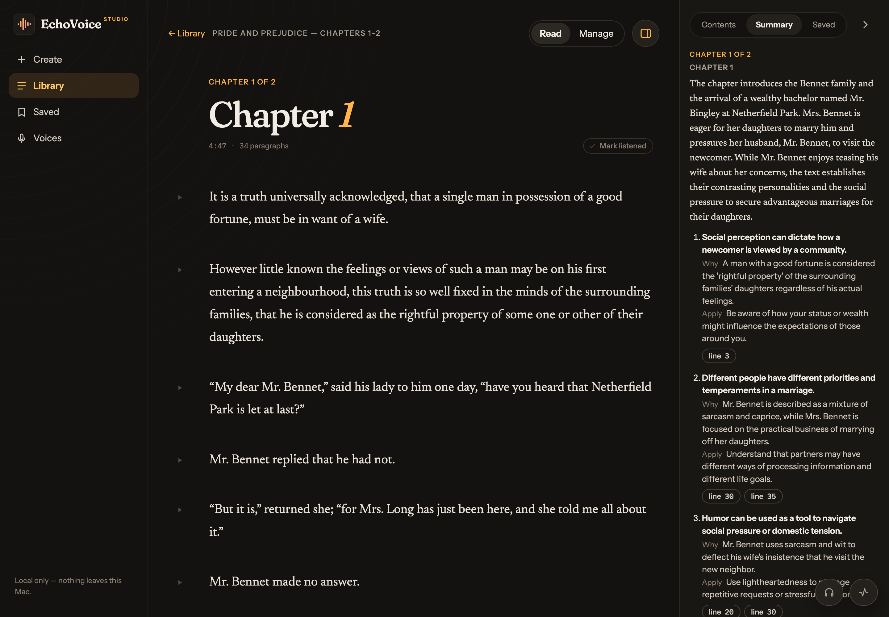
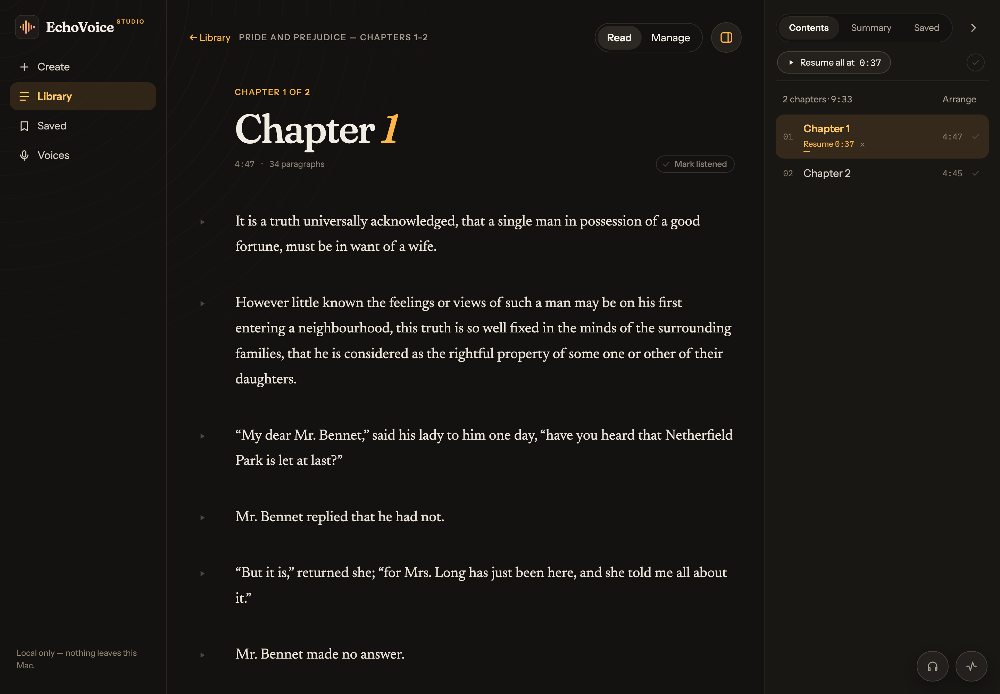
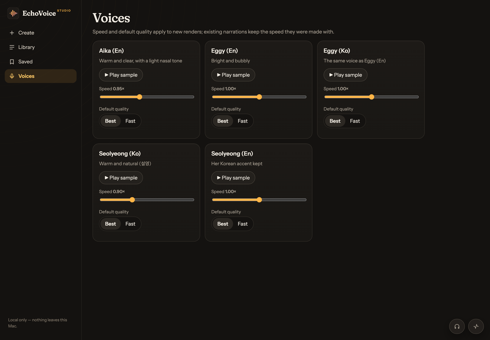
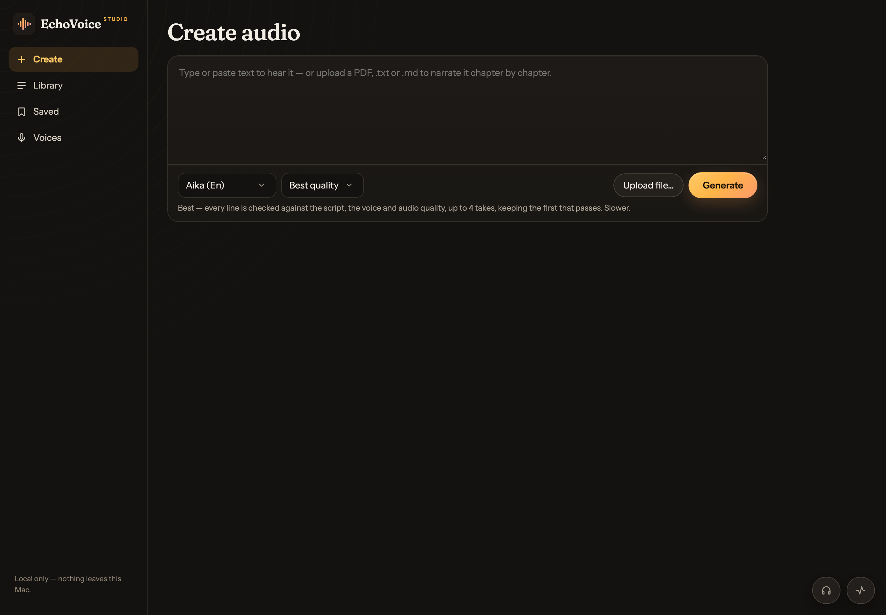

# EchoVoice — natural speech, judged before it ships. (Public)

A local voice engine on the Mac: text in, natural-sounding speech out. One engine with thin front-ends: pre-rendered Korean audio for [Lingus](https://github.com/AC-DAC/Lingus-Public), [audiobooks](#audiobooks) from PDFs and notes in a local studio, and the voice of a desktop assistant.

Every take is judged before it's used. Failing takes are re-rolled, and a line that still fails after the cap is flagged for review, never shipped silently.

This is a showcase repo: README only. The source is private.

---

## The problem

Lingus needed hundreds of Korean voice lines that sound like a person, not a screen reader. The cloud voices it started with didn't: in a blind listening set with Azure's Korean voice hidden among the candidates, it was rejected on all 10 lines.

Paying a cloud TTS service per character was the other option. The Mac and the homelab were already there, so self-hosting an open model was cheaper and kept every line of text and audio on the machine.

The harder problem turned out to be quality control. An open TTS model invents rhythm and emphasis on every take, so the same line can come out well or badly. EchoVoice is mostly the machinery around the model: judging each take, picking the best, and measuring what "sounds right" actually means.

---

## Architecture

```
┌──────────────────────────────────┐
│  Front-ends (thin)               │
│  Lingus lines · studio uploads   │
│  (PDF / .txt / .md) · assistant  │
└────────────┬─────────────────────┘
             │ 1. lines in: key, text, voice, speed, style
             ▼
┌──────────────────────────────────┐
│  Text                            │
│  spoken form (numbers, dates,    │
│  units, URLs) · clause chunking  │
└────────────┬─────────────────────┘
             │ 2.
             ▼
┌──────────────────────────────────┐
│  Render — Qwen3-TTS 1.7B on MLX  │
│  Base (cloned voices) ·          │
│  CustomVoice (fine-tuned voices) │
└────────────┬─────────────────────┘
             │ 3. each take
             ▼
┌──────────────────────────────────┐
│  Judge                           │
│  words heard · dropped words ·   │
│  voice match · quality · signal  │
└────────────┬─────────────────────┘
             │ 4. pass → keep · fail → re-roll (up to 4)
             ▼
┌──────────────────────────────────┐
│  Out                             │
│  breath trim · mp3 · manifest    │
└──────────────────────────────────┘
```

**Engine first, front-ends thin.** Every front-end shares the same engine, judge and voice presets. A front-end only turns its input into lines and its output into files.

**A file contract, not imports.** Other projects talk to EchoVoice through files: lines in, audio plus `manifest.json` out. No imports across repos and no hard-coded paths into them. Lingus serves the finished clips as static files from a Raspberry Pi, so they work from any device, even while the Mac is asleep.

**Two processes.** The studio (web page, audio, edits) loads no models: about 56 MB fresh, down from about 1 GB before the split. The models live in a render worker that starts on demand, listens only to the studio on localhost, and exits after 10 idle minutes.

---

## The judge

Each take is transcribed and compared to its text, then checked for voice and audio quality.

| Check | How |
|---|---|
| Words heard | whisper.cpp large-v3-turbo + Silero VAD, compared to the text |
| Dropped words | A second, literal transcript (MMS-1b) |
| Voice match | Speaker embedding (ECAPA) against the voice's reference |
| Quality | Automatic MOS prediction (UTMOS) |
| Signal | Pace, abrupt endings, noise, long gaps |

- **Strict and Lenient.** Strict gates batch renders. Lenient is for real-time use and the last-resort pick when Strict runs out of takes.
- **Measurement fixes vs leniency.** Some rules only stop the judge rejecting *correct* takes because of how Whisper writes things: Korean compared by sound as well as spelling (the same converter Lingus uses for grading), numbers compared as digits either way, typography folded. Both versions use those. Real leniency (a lower pass mark, accent as a hint) is Lenient-only.
- **Calibrated by ear.** Thresholds are set from takes marked by ear, and a planted-failures bench measures what the judge catches on deliberately broken clips.
- **Honest limits.** The judge catches broken takes: misreads, dropped words, truncation, silence. It doesn't catch what the ear rejects for tone or emphasis. By-ear review is still the final gate, and the studio is built around making it fast.

---

## Measure before tuning

"Sounds natural" is decided by blind listening tests, not by settings that look right.

- **Automatic signals couldn't predict the ear.** After the first review of 248 Korean clips, every automatic signal was scored against the marks: Whisper word confidence AUC 0.56–0.60, pace 0.53, transcript match 0.50 (a coin flip). Whisper hears the right words even when they're mushy, so what gets rejected (tone, odd emphasis, uneven pace) has no metric. More labels don't fix a missing signal.
- **Blind sets, built properly.** The same lines in several versions, shuffled and unlabelled. Each set has a **control** (Azure's voice went in blind and was rejected 10/10, settling the direction in one set), a **hidden duplicate** (the same take twice, marked alike on 8 of 10 lines, which measures how consistent the ear is), **reject reasons** (too fast, unclear, cut off, odd emphasis, tone) and fresh lines each time.
- **Compare within a set, not across sets.** Absolute approval rates drift with fatigue and a rising bar. Only versions inside one set are comparable.
- **Settings hit a ceiling.** Temperature, speed, instructions and chunking all landed the stock Korean voice at 40–50% acceptable takes.
- **So the voice was fine-tuned on approvals.** Qwen's official single-speaker fine-tuning, ported to Apple Silicon (MPS) on a 24 GB Mac, trained on takes approved by ear. The fine-tuned voice scored 39/40 in a blind sample and now voices every Korean line in Lingus.

---

## Voices

https://github.com/user-attachments/assets/4f4eb768-b2ce-4cdc-859a-20235a1dbd5d

| Voice | What |
|---|---|
| **Seolyeong (Ko)** · `seolyeong` | Seol-yeong (설영). Korean, female. Fine-tuned from Qwen's stock sohee speaker on takes approved by ear. Lingus's voice. |
| **Seolyeong (En)** · `seolyeong-en` | Seolyeong speaking English with her Korean accent kept. The same fine-tuned weights asked for English beat a cross-lingual clone of her Korean clips (12/18 vs 7/18 kept, blind). A soft, slightly shy style was picked over three alternatives; an American-English variant was tried and dropped. |
| **Aika (En)** · `aika` | English, a long-form reading voice. Designed from a written description with Qwen's voice design model, locked by cloning the picked take, then shaped by ear: slightly lighter resonance, a nasal midrange, a trimmed low end and a touch slower. See [Shaping a voice by ear](#shaping-a-voice-by-ear). |
| **Eggy (En)** · `eggy` | Bright and bubbly. The desktop assistant's voice. Designed from a written description, picked by ear, then locked by cloning its own approved take so it stays the same voice. |
| **Eggy (Ko)** · `eggy-ko` | The same voice speaking Korean: a cross-lingual clone from the English reference. |
| **Sohee (Ko)** · `sohee-calm` | Stock sohee with tuned sampling. The control in blind tests and the base for fine-tuning. |

A voice is a small preset file (plus a reference clip for clones, or weights for a fine-tune), so adding one doesn't touch the engine. Each has a display name for the studio; the ID stays what code and other projects use. A preset can also carry its own processing (a resonance shift and an audio filter chain), applied to every take before the judge, so calibration scores exactly what ships. Every voice is calibrated by ear.

---

## Shaping a voice by ear

Aika started as one take from Qwen's voice design model. Turning that into a long-form reading voice took about ten blind rounds and a live tuning page.

- **Brightness boosts failed.** Every version with added high frequencies was rejected (0 of 18 in one set; notes: "fuzz and air"), and a long listen to the brightest one caused fatigue. A cloned voice has little harmonic content up top, so EQ lifts hiss rather than clarity.
- **Pitch lowering failed too.** Resampling a take down 1–1.5 semitones before cloning was rejected on every line (0/12): it shifts the voice's resonances as well, and sounds processed.
- **A nasal midrange worked.** Adding it took the same takes from 0/6 to 5/6 in one blind set.
- **Then a dials page.** A local page with live controls: a 10-band graphic EQ with a response curve, movable nasal, bass and air bands, saturation, a split-band de-esser and compression run live in the browser (Web Audio); resonance and pitch swap pre-rendered takes; pace is rendered on demand. Settings are saved by name and converted to the same filter chain offline, then confirmed by ear before they're locked.

---

## Audiobooks

The studio's biggest job: turning documents into audiobooks, end to end on the Mac.



- **In:** a PDF, .txt or .md. PDFs are read by layout, not tags: the body font is the size carrying the most text, headings are clearly larger or short all-bold blocks. Page numbers, running headers and footers, and contents pages are always dropped; footnotes, the reference list, appendices, tables, captions and citations (a year in brackets, [12]-style numbers, URLs) can be. The text that will be read is shown, and editable, before anything renders.
- **Spoken form:** "p. 42" becomes "page 42", years and numbers are read as words, units, fractions and URLs are spelled out the way a person would say them. Render-only respellings fix what the model mispronounces without changing the text you see.
- **Rendered like everything else:** every line goes through best-of-N and the judge; long paragraphs split at clause boundaries; a stopped job resumes where it left off; flagged lines are listed, never hidden. Out comes one mp3 per chapter and one for the whole document.
- **Read along:** the Read view shows the chapter as a page of text, with the paragraph and the word being spoken highlighted (word timings from Whisper).


- **The player:** a waveform seek bar drawn from the real audio, ±15 s, chapter skip, 0.25–2× with pitch kept, a sleep timer and media keys. Highlights, bookmarks and notes are anchored to the text; chapters tick off as they're finished; one reading position per audiobook is kept across devices.
- **Summaries:** each chapter gets its key lessons written by a local LLM (Gemma 4 12B through Ollama), so an audiobook can be revisited without replaying it.
- **Scale:** the longest so far was 6,857 lines, about 32.7 hours of audio. That's where the engineering notes below come from: the memory "leak", the 42 GB join and the streaming fix were all found narrating it.

Documents and their audio never leave the Mac, and none of them are in any repo: tests use neutral examples.

---

## The studio

A local web app for everything that isn't Lingus: audiobooks, single lines, review and voices.



- **Create.** Type a line, or upload a PDF, .txt or .md file. Documents are split into headings and paragraphs and narrated into section mp3s plus one full file.
- **Library.** Every narration and its chapters, with the Read view, player and summaries described in [Audiobooks](#audiobooks).
- **Flagged lines.** Flagged lines are listed with why they failed. **Give me 3 takes** renders three fresh versions beside the current one; keeping one logs the chosen and rejected audio as training pairs for the next fine-tune.
- **Voices.** Hear a sample of each voice, listed by display name.



The assistant front-end is a Claude Code hook: each reply is summarised and spoken in `eggy`'s voice through the studio's HTTP API.

---

## Engineering notes

**A 68 GB "leak" that wasn't one.** After 4.5 days rendering a long document, the studio reached a 68 GB footprint on a 24 GB Mac. Nothing was holding a reference. Each neural check (UTMOS, ECAPA, MMS) keeps memory in proportion to the longest audio it has judged, and in one long-lived process the three ratcheted together instead of levelling off. Every part tested alone on short clips was flat; the bug only appeared with long audio and all three together. Fix: judge long audio in 60 s windows and release memory after each take. Same loop: +9.9 GB and rising → **+0.5 GB, flat**, with zero changed verdicts on 40 long paragraphs. Lesson: test with the biggest realistic input, and test the parts together.

**Joining 32 hours of audio.** The first join kept every decoded clip and concatenated the whole narration into one array: a **42.4 GB** peak. It now streams each section clip by clip into a file on disk and encodes the full mp3 from those files: **263 MB** peak, with output **byte-identical** to the old join.

**Streaming playback.** Seeking in a 1.3 GB mp3 made the studio read the whole requested range into memory before sending it, and players ask for "the rest of the file" then hang up. It now streams 1 MB at a time and treats a hang-up as normal: five seeks went from +2.8 GB to flat.

**Calibration that matches what ships.** Calibration takes were first rendered whole, with the default trim, while real renders split a line into sentences and trim each voice its own way. For one voice that meant calibration takes that dropped second sentences, and thresholds set on audio it never ships. Calibration now renders exactly like production.

**Calibrating a clone without changing it.** For a cloned voice the reference clip is the source it clones from, and calibration takes already carry the voice's processing. Making a calibration take the new reference would have applied that processing twice. For clones, the chosen take becomes the judge's comparison clip and the source stays put.

**A rename that re-rendered a checked narration.** Adding one chapter to a Korean edition re-rendered all 668 lines overnight (7 h 20 min) when only 155 were new. A clip's key hashes the model version, voice, style, speed and text. Three days earlier a voice had been renamed, and the migration rewrote each manifest's `voice` field but not the keys, so every existing clip sat under a key nothing would look up. The renderer said "668 lines to render" and nothing compared that with the 155 expected. It replaced 513 lines that had already passed a meaning check and been approved with unchecked takes, and the new takes were worse (8 failed lines against 1). Nothing was lost, because a render never deletes a take: 500 old takes were restored under the new keys, and the 8 lines already re-judged by ear that morning were kept, since a by-ear decision is newer than the checked take. The same fault was found waiting in Lingus's 347-clip set and re-keyed before it fired.

The fix is a guard rather than a reminder. Before loading a model, `render` and `narrate` look for lines with no clip under their key but one under another key with the same text, speed and voice, and refuse with the count. A speed-only change is refused too, because one edit on the Voices page would otherwise re-render a whole set. A `rekey` command points the new keys at the clips that exist (with backups), and an explicit override renders anyway. Replayed on the incident, the guard refuses 508 lines; run on every current folder, it finds nothing. Lessons: a rename that keeps the name inside a hash is a data migration, not a find-and-replace; a render that touches more than expected should stop and say so; and when a count disagrees with the record, find out why before acting on the lines.

**Clipped first words.** Voice activity detection at its default threshold heard the assistant voice's first word late, so the trim cut it. Each voice now carries its own detection threshold, used by both the trim and the judge's silence check.

---

## Rejected alternatives

- **Azure's Korean voices** — rejected 10/10 in a blind set.
- **A paid cloud TTS service** — per-character cost, and text and audio leave the machine. The Mac was already there.
- **A live TTS service for Lingus** — would only work while the Mac is awake. Pre-rendered static clips work everywhere.
- **Docker** — no Metal GPU access inside Docker on macOS.
- **Slowing audio a lot with ffmpeg** — 0.8× time-stretching smeared consonants. Small changes are fine (Aika reads at 0.95×); bigger ones have to come from the model.
- **Inline markup for emphasis and pauses** — Qwen3-TTS has no word-level controls; tags like `[pause]` were read aloud or garbled.
- **High-frequency boosts for brightness** — rejected as fuzz on a cloned voice (0/18); a nasal midrange did the job instead.
- **Resampling to lower a voice's pitch** — moves the resonances too; 0/12 in a blind set.
- **Cross-lingual clones for an accented Korean voice** — came out as a "robotic foreigner" (2–3 of 6 kept); parked.
- **The 0.6B model for the assistant voice** — near parity in a blind test (6/8 vs 7/8 for 1.7B) but slower per line because of more re-rolls. Kept 1.7B.

---

## Privacy and security

- Rendering and judging run on the Mac: no cloud TTS, and document text and audio stay on the machine.
- The render worker binds to localhost and accepts requests only from the studio.
- The studio has one admin, the Mac itself (loopback). It can optionally serve HTTPS to the home network as listen-only: listeners can play and read, and every change is refused (403). It has no public DNS record, so it can't be reached from outside the home network.
- Model weights, renders and uploaded documents are gitignored; tests use neutral examples, never the content of a real document.
- Pre-commit hooks scan every commit for secrets and private terms before it leaves the Mac.

---

## Stack

`Python` `Qwen3-TTS` `MLX` `whisper.cpp` `Silero VAD` `MMS` `SpeechBrain ECAPA` `UTMOS` `PyTorch (MPS)` `Ollama` `Gemma 4` `ffmpeg` `pytest`
